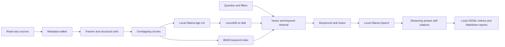

# uni-rag

A fully local, transparent RAG assistant for German and English university material.
Python 3.12, Ollama, LanceDB and an explicit parsing/retrieval pipeline; no LangChain or LlamaIndex.

## Setup

Install uv and Ollama, then install the project and local models:

```sh
uv sync --locked
ollama pull bge-m3
ollama pull qwen3:4b
ollama pull qwen3:14b
ollama pull qwen3:30b-a3b
cp config.example.toml config.toml
```

Model and package downloads are setup steps. Runtime requires only the local Ollama service.
Edit the two placeholder source paths in `config.toml`. Paths expand the leading `~`, preserve
spaces and embedded `~` characters, and resolve relative to the configuration file.
The personal config, `data/`, environment and caches are gitignored.

Start with the synthetic fixtures, independently of personal configuration:

```sh
uv run python tests/make_fixtures.py
uv run rag ingest --config tests/fixtures.config.toml --dry-run
uv run rag ingest --config tests/fixtures.config.toml
uv run rag ask --config tests/fixtures.config.toml "What is hybrid retrieval?"
```

Inspect metadata before a large ingestion:

```sh
uv run rag ingest --source tuwien --dry-run
uv run rag ingest --source obsidian --only Courses --limit 100 --dry-run
caffeinate -i uv run rag ingest
uv run rag ask "Was ist Reciprocal Rank Fusion?" --source tuwien --k 8 --no-think
uv run rag ask "Which languages are accepted?" --show-context --file-type .docx
```

Dry runs read directory entries and stat metadata, not document contents. Counts and bytes by
source/type, largest immediate parent folders and skip reasons are written to `data/reports/`.
Skipped directories are logged as one directory record; their descendants are not traversed.
For permission failures, allow the terminal app in System Settings → Privacy & Security →
Files and Folders (or Full Disk Access).

## Architecture



`src/uni_rag/` keeps configuration, ingestion, storage, retrieval and generation separate.
Chunk size uses an approximate four-character token estimate; exact model token counts come
from Ollama. Markdown headings and PDF page boundaries are preserved. Short adjacent slides
merge with an inclusive slide range; other slides stay whole, including their speaker notes.

## Privacy

Documents never leave the machine and are never modified, moved or copied. Only extracted
text, metadata and vectors are stored under `data/`. The HTTP client only accepts loopback
Ollama URLs, ignores proxy environment variables and does not follow redirects. No remote
embedding, tokenizer, OCR or telemetry service is used. Do-not-track and Hugging Face offline
flags are set before importing dependencies. Prompts treat document text as untrusted context.

Development and tests use only original synthetic fixtures. They never load `config.toml`.

## Limitations

- No OCR; scanned or empty PDF pages are logged. Images, figures and embedded images are ignored.
- iCloud placeholders and cloud-only (SF_DATALESS) files are skipped before content reads.
- Symlinks are skipped. Archives and binary formats are not unpacked.
- Approximate chunk token counts may need tuning for formulas, code and very large slides.
- Grounding is prompted, not guaranteed: inspect citations and retrieved context.

## Results

No benchmark has been run against personal documents. `rag report` will write a filled table
under `data/reports/` for manual inclusion here.

| Model | Think | Queries | Median latency (s) | Median TTFT (s) | Tokens/s | Gross J/answer | Above-idle J/answer | Hit@k |
|---|---|---|---|---|---|---|---|---|
| — | — | — | — | — | — | — | — | — |

## Development

```sh
uv run ruff check .
uv run ruff format --check .
uv run pytest
```

Tests use mock Ollama responses and synthetic documents. All test scratch files stay in
the project cache. The dependency resolution is pinned in `uv.lock`.

## Incremental indexing and retrieval

The SQLite manifest records source, relative path, byte size, nanosecond mtime and SHA1.
Unchanged size/mtime skips content reads. Changed files are hashed; exact duplicate bytes
share one set of vectors and retain every source path. Each completed embedding batch is
durable. A file becomes searchable only when all its chunks are committed in the manifest.
Rerunning the same command reuses completed batches after interruption or sleep.

Deleted and newly excluded files are removed after a successful scan of the selected scope.
`--limit` never deletes files. Permission failures and cloud-only subtrees preserve existing
manifest entries. Parse failures retain the previous successful version and are logged.
Changing embedding/chunk settings or a named source root requires a fresh `storage.data_dir`.
Run only one ingest at a time.

Hybrid retrieval uses cosine top-k and BM25 top-k, with RRF score `sum(1/(60 + rank))` by
default. Filters apply before either ranking, including aliases of duplicate files. BM25
uses Unicode word tokenization with no stopword list, stemming or language downloads.
The keyword cache is rebuilt from active chunks when the manifest revision changes.
Vector scans are exact; metadata loading and BM25 rebuilding scale with corpus size.

```sh
uv run rag chat --source obsidian --no-think
```

Chat is an interactive sequence of independently grounded, self-contained questions.
Answers list the sources actually cited; out-of-range model citations are marked invalid.
