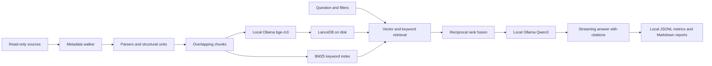

# uni-rag

A fully local, transparent RAG assistant for German and English university material.
Python 3.12, Ollama, LanceDB and an explicit parsing/retrieval pipeline; no LangChain or LlamaIndex.

## Setup

Install uv and Ollama, then install the project and local models:

```sh
export UV_CACHE_DIR="$PWD/.cache/uv"
export UV_PYTHON_INSTALL_DIR="$PWD/.cache/python"
uv sync --locked
ollama pull bge-m3
ollama pull qwen3:4b
ollama pull qwen3:14b
ollama pull qwen3:30b-a3b
cp config.example.toml config.toml
```

Model and package downloads are setup steps. Runtime requires only the local Ollama service.
Skip model pulls if they are already installed. After setup, `uv run --offline --locked rag ...`
also prevents uv itself from contacting package registries.
Edit the two placeholder source paths in `config.toml`. Paths expand the leading `~`, preserve
spaces and embedded `~` characters, and resolve relative to the configuration file.
The personal config, `data/`, environment and caches are gitignored.

Start with the synthetic fixtures, independently of personal configuration:

```sh
uv run python tests/make_fixtures.py
uv run rag ingest --config tests/fixtures.config.toml --dry-run
uv run rag ingest --config tests/fixtures.config.toml
uv run rag ask --config tests/fixtures.config.toml "What is hybrid retrieval?"
```

Inspect metadata before a large ingestion:

```sh
uv run rag ingest --source tuwien --dry-run
uv run rag ingest --source obsidian --only Courses --limit 100 --dry-run
caffeinate -i uv run rag ingest
uv run rag ask "Was ist Reciprocal Rank Fusion?" --source tuwien --k 8 --no-think
uv run rag ask "Which languages are accepted?" --show-context --file-type .docx
```

Dry runs read directory entries and stat metadata, not document contents. Counts and bytes by
source/type, largest immediate parent folders and skip reasons are written to `data/reports/`.
Skipped directories are logged as one directory record; their descendants are not traversed.
For permission failures, allow the terminal app in System Settings → Privacy & Security →
Files and Folders (or Full Disk Access).

## Architecture



`src/uni_rag/` keeps configuration, ingestion, storage, retrieval and generation separate.
Chunk size uses an approximate four-character token estimate; exact model token counts come
from Ollama. Markdown headings and PDF page boundaries are preserved. Short adjacent slides
merge with an inclusive slide range; other slides stay whole, including their speaker notes.
Chat requests explicitly set Ollama's `num_ctx` from `[ollama] context_window` (default 8192),
and record it with each query. Tune this alongside k and chunk size for memory and context
limits; exceptionally large slides or chat histories can still exceed the model's context.

## Privacy

Documents never leave the machine and are never modified, moved or copied. Only extracted
text, metadata and vectors are stored under `data/`. The HTTP client only accepts loopback
Ollama URLs, ignores proxy environment variables and does not follow redirects. No remote
embedding, tokenizer, OCR or telemetry service is used. Do-not-track and Hugging Face offline
flags are set before importing dependencies. Prompts treat document text as untrusted context.

Development and tests use only original synthetic fixtures. They never load `config.toml`.

## Limitations

- No OCR; scanned or empty PDF pages are logged. Images, figures and embedded images are ignored.
- iCloud placeholders and cloud-only (SF_DATALESS) files are skipped before content reads.
- Symlinks are skipped. Archives and binary formats are not unpacked.
- Approximate chunk token counts may need tuning for formulas, code and very large slides.
- Grounding is prompted, not guaranteed: inspect citations and retrieved context.

## Results

No benchmark has been run against personal documents. `rag report` will write a filled table
under `data/reports/` for manual inclusion here.

| Model | Think | Queries | Median latency (s) | Median TTFT (s) | Tokens/s | Gross J/answer | Above-idle J/answer | Hit@k |
|---|---|---|---|---|---|---|---|---|
| — | — | — | — | — | — | — | — | — |

## Development

```sh
uv run ruff check .
uv run ruff format --check .
uv run pytest
```

Tests use mock Ollama responses and synthetic documents. All test scratch files stay in
the project cache. The dependency resolution is pinned in `uv.lock`.

## Incremental indexing and retrieval

The SQLite manifest records source, relative path, byte size, nanosecond mtime and SHA1.
Unchanged size/mtime skips content reads. Changed files are hashed; exact duplicate bytes
share one set of vectors and retain every source path. Each completed embedding batch is
durable. A file becomes searchable only when all its chunks are committed in the manifest.
Rerunning the same command reuses completed batches after interruption or sleep.

Deleted and newly excluded files are removed after a successful scan of the selected scope.
`--limit` never deletes files. Permission failures and cloud-only subtrees preserve existing
manifest entries. Parse failures retain the previous successful version and are logged.
Changing embedding/chunk settings or a named source root requires a fresh `storage.data_dir`.
Run only one ingest at a time.

Hybrid retrieval uses cosine top-k and BM25 top-k, with RRF score `sum(1/(60 + rank))` by
default. Filters apply before either ranking, including aliases of duplicate files. BM25
uses Unicode word tokenization with no stopword list, stemming or language downloads.
The keyword cache is rebuilt from active chunks when the manifest revision changes.
Vector scans are exact; metadata loading and BM25 rebuilding scale with corpus size.

```sh
uv run rag chat --source obsidian --no-think
```

Chat retains the last three turns in memory to interpret follow-up questions. Retrieval
uses the current question and up to two previous questions; previous answers are not evidence.
Exiting clears the conversation. Current retrieved excerpts supply fresh citation numbers.
Answers list the sources actually cited; out-of-range model citations are marked invalid.

## Measurements and power

```sh
uv run rag stats
uv run rag ask "What is MRR?" --energy auto --no-think
```

Every attempted query writes a JSONL record to `data/metrics/`: model, think setting,
question ID, query ID, k, retrieval time, visible-answer TTFT, total query time, prompt and
completion tokens, and decode tokens/s from Ollama's `eval_count/eval_duration`. Total time
covers retrieval through the final streamed event. The first model token is recorded
separately from visible TTFT when thinking is enabled. No token counts are inferred when
Ollama does not provide them. Metrics contain no question or document text.

Set `[energy] energy_backend = "auto"` in config, or override it with
`--energy auto|macmon|powermetrics|none`. Auto starts macmon's JSON `pipe` mode, then tries an
existing powermetrics log, then records null. Macmon is optional (`brew install macmon`).
The app never invokes sudo. To sample externally in another terminal, from this project:

```sh
mkdir -p data
sudo powermetrics --samplers cpu_power,gpu_power -i 200 -o data/power.log
```

Power measurements sum CPU, GPU and ANE, in watts; this is not whole-system/battery energy.
All three components must be present. Readings integrate by the trapezoidal rule, with
interpolation only between adjacent measured points covering the entire query window.
Missing endpoints, gaps, stale logs and sampler failures produce null, with a warning;
no power is extrapolated. Powermetrics headers can have one-second timestamp precision:
readings sharing a timestamp are averaged, and the observed interval is recorded separately
from the requested 200 ms interval. Use macmon for finer timestamp alignment.

Every metric includes the requested/used backend and configured/observed sampling interval.
Sampler startup and waiting for the trailing power reading are excluded from query latency.
Only eval measures idle baseline, after warm-up. Gross energy and energy above that baseline
are stored separately; baseline values are never reused across different backends.
Above-idle energy can be negative due to ordinary baseline variation and is not clamped.
Ask/chat record null above-idle energy because they do not measure an idle baseline.

## Evaluation and reports

Copy the example to create your own private question set (the example uses fixtures only):

```sh
cp eval/questions.example.yaml eval/questions.yaml
uv run rag eval --config tests/fixtures.config.toml \
  --questions eval/questions.example.yaml \
  --models qwen3:4b,qwen3:14b,qwen3:30b-a3b --energy auto --no-think
uv run rag report --config tests/fixtures.config.toml
# For your private corpus, edit eval/questions.yaml, then run without --config:
uv run rag eval --questions eval/questions.yaml \
  --models qwen3:4b,qwen3:14b,qwen3:30b-a3b
uv run rag report
```

Keep private question sets under `data/` (recommended), or use the ignored
`eval/questions.yaml`. Each question has a unique `id`, a `question`, `expected_sources`
(source/path substrings, any match counts), and an optional `reference_answer`.
An empty expected list marks an out-of-scope question; `out_of_scope: true` can make this
explicit. The loader also accepts `expected_source_substrings`.

Selected models are unloaded before the benchmark. Each model gets one full retrieval/answer
warm-up before its idle baseline and measured questions, then is unloaded with `keep_alive: 0`.
Warm-up metrics are labelled and excluded from results. Other applications and system activity
can still affect measurements; no inference is made about whole-machine battery usage.
Model labels describe small dense (4b), medium dense (14b), and mixture-of-experts (30b-a3b).

Evaluation writes a unique run directory in `data/eval/`: settings/baselines in `run.json`
and flushed per-answer rows in `results.jsonl`. A failed question is recorded and remaining
questions continue. Results include hit@k, MRR, actual expected-source citation matches,
invalid citation IDs and an explicit English/German missing-information text heuristic.
Retrieval/citation metrics exclude out-of-scope questions; admission rate uses only those
questions. These checks measure retrieval and attribution, not full answer correctness.

Optional `--judge-model qwen3:14b` runs a separate local LLM-as-judge phase after all timed
model runs, and writes labelled opinions to `judgments.jsonl`. Judge failures are recorded;
they do not invalidate measured answers. No remote judge is supported.

`rag report` writes `data/reports/summary.md` for the latest completed/partial eval run.
Use `--run-id ID` to select a particular run (including interrupted runs). It reports medians
for latency, visible TTFT, decode throughput and energy, plus hit@k/MRR and answer checks.
Energy backends are grouped separately and the count of covered answers is shown. Missing
measurements remain `—`. Copy the resulting table into the empty Results section above.

Runtime direct dependencies: Typer, Rich, HTTPX, LanceDB, PyArrow, BM25s (indexing extra),
PyMuPDF 1.x, python-pptx, python-docx and PyYAML. Development adds Ruff and pytest.
Every direct and transitive version is pinned in `uv.lock`.
