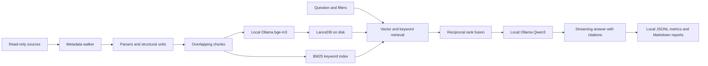

# uni-rag

A fully local, transparent RAG assistant for German and English university material.
Python 3.12, Ollama, LanceDB and an explicit parsing/retrieval pipeline; no LangChain or LlamaIndex.

**v0.1 results** on a MacBook Pro M5 over about 4,300 of my own files
(60 questions; details in [Results](#results-v01)):

- **Retrieval is the main limitation:** the expected source is in the top 8 for
  20 of 45 answerable questions. When it is retrieved, the 14B and 30B models
  cite it in 18 of 20 cases.
- **Mixture-of-experts wins on this laptop:** Qwen3-30B-A3B answers 2.7× faster
  than dense Qwen3-14B with about half the energy per answer (185 vs 362 J) and
  the same citation rate.
- **Thinking costs 2.8–5.5× the energy per answer** and did not improve the 30B
  model's citations.
- **Next (v0.2):** reranking and per-document diversity in retrieval, measured
  on the same questions.

## Setup

Install uv and Ollama, then install the project and local models:

```sh
export UV_CACHE_DIR="$PWD/.cache/uv"
export UV_PYTHON_INSTALL_DIR="$PWD/.cache/python"
uv sync --locked
ollama pull bge-m3
ollama pull qwen3:4b-q4_K_M
ollama pull qwen3:14b
ollama pull qwen3:30b-a3b-q4_K_M
cp config.example.toml config.toml
```

Model and package downloads are setup steps. Runtime requires only the local Ollama service.
Skip model pulls if they are already installed. After setup, `uv run --offline --locked rag ...`
also prevents uv itself from contacting package registries.
Edit the two placeholder source paths in `config.toml`. Paths expand the leading `~`, preserve
spaces and embedded `~` characters, and resolve relative to the configuration file.
The personal config, `data/`, environment and caches are gitignored.

Start with the synthetic fixtures, independently of personal configuration:

```sh
uv run python tests/make_fixtures.py
uv run rag ingest --config tests/fixtures.config.toml --dry-run
uv run rag ingest --config tests/fixtures.config.toml
uv run rag ask --config tests/fixtures.config.toml "What is hybrid retrieval?"
```

Inspect metadata before a large ingestion:

```sh
uv run rag ingest --source tuwien --dry-run
uv run rag ingest --source obsidian --only Courses --limit 100 --dry-run
caffeinate -i uv run rag ingest
uv run rag ask "Was ist Reciprocal Rank Fusion?" --source tuwien --k 8 --no-think
uv run rag ask "Which languages are accepted?" --show-context --file-type .docx
```

Dry runs read directory entries and stat metadata, not document contents. Counts and bytes by
source/type, largest immediate parent folders and skip reasons are written to `data/reports/`.
Skipped directories are logged as one directory record; their descendants are not traversed.
For permission failures, allow the terminal app in System Settings → Privacy & Security →
Files and Folders (or Full Disk Access).

## Architecture



`src/uni_rag/` keeps configuration, ingestion, storage, retrieval and generation separate.
Chunk size uses an approximate four-character token estimate; exact model token counts come
from Ollama. Markdown headings and PDF page boundaries are preserved. Short adjacent slides
merge with an inclusive slide range; other slides stay whole, including their speaker notes.
Chat requests explicitly set Ollama's `num_ctx` from `[ollama] context_window` (default 8192),
and record it with each query. Tune this alongside k and chunk size for memory and context
limits; exceptionally large slides or chat histories can still exceed the model's context.

## Privacy

Documents never leave the machine and are never modified, moved or copied. Only extracted
text, metadata and vectors are stored under `data/`. The HTTP client only accepts loopback
Ollama URLs, ignores proxy environment variables and does not follow redirects. No remote
embedding, tokenizer, OCR or telemetry service is used. Do-not-track and Hugging Face offline
flags are set before importing dependencies. Prompts treat document text as untrusted context.

Development and tests use only original synthetic fixtures. They never load `config.toml`.

## Limitations

- No OCR; scanned or empty PDF pages are logged. Images, figures and embedded images are ignored.
- iCloud placeholders and cloud-only (SF_DATALESS) files are skipped before content reads.
- Symlinks are skipped. Archives and binary formats are not unpacked.
- Approximate chunk token counts may need tuning for formulas, code and very large slides.
- Grounding is prompted, not guaranteed: inspect citations and retrieved context.

## Results (v0.1)

Measured on a MacBook Pro (Apple M5, 32 GB unified memory) with Ollama, fully offline.
Corpus: my own university documents (Obsidian notes and TU Wien course and research material),
4,297 files and 266,057 chunks, embedded with bge-m3. Hybrid retrieval (LanceDB vectors + BM25,
reciprocal rank fusion), k = 8, context window 8,192 tokens.

Evaluation set: 60 questions generated with an LLM from the corpus; 45 are answerable and
15 are deliberately out of scope. Questions and answers stay private; only aggregates are published.

Protocol: each question is retrieved once and all models answer from the same retrieved chunks.
Models are warmed up before timed questions and unloaded between model runs. The thinking run
was resumed once, with an additional warm-up and idle baseline for the resumed 4B segment.
Latency and energy cover generation only; retrieval is timed separately (median
1.117 s per question). Warm-up and sampler startup are excluded;
any residual per-request model loading is included. Tables show medians over 60 generation
attempts per model, except visible-answer TTFT when no answer was produced.
Runs: main `20261104T075907Z-4117b883`, thinking `20261104T083232Z-89bb4162`.

### Retrieval (45 answerable questions)

| Metric | Strict | Lenient |
|---|---|---|
| Hit@8 | 0.444 (20/45) | 0.489 (22/45) |
| MRR | 0.282 | 0.326 |

Strict: an expected source matches a top-8 chunk, including page/slide when annotated.
Lenient: also accepts a different copy (same normalised filename stem, or document-level
five-word-shingle Dice similarity ≥ 0.95). A wrong page in the same file does not count as a copy.

### Generation (thinking off, max 512 output tokens, ~150-word answers)

| Model | Architecture | Latency (s) | TTFT (s) | Decode tokens/s | Energy (J/answer) | Cites expected source | Admits missing (out of scope) |
|---|---|---|---|---|---|---|---|
| qwen3:4b-q4_K_M | dense, 4B | 6.2 | 4.0 | 34.5 | 117 | 14/45 | 15/15 |
| qwen3:14b | dense, 14B | 17.6 | 12.1 | 11.6 | 362 | 18/45 | 7/15 |
| qwen3:30b-a3b-q4_K_M | MoE, 30B total / 3B active | 6.5 | 4.8 | 40.5 | 185 | 18/45 | 13/15 |

Decode tokens/s is Ollama's completion-token count divided by its evaluation duration in
seconds (`eval_count / (eval_duration / 1e9)`), rather than tokens divided by wall-clock latency.
TTFT is time to the first visible answer token, including prompt processing and any residual load.

Energy is gross energy per answer, measured with macmon (CPU+GPU+ANE) over the generation
window, not whole-system or battery energy. Energy was recorded for 180/180 answers.

### Thinking variants (separate run, max 4,096 output tokens)

| Model | Reasoning tokens | Answer tokens | Latency (s) | Visible-answer TTFT (s) | Energy (J/answer) | Cites expected source |
|---|---|---|---|---|---|---|
| qwen3:4b-thinking-2507-q4_K_M | 966.5 | 94 | 33.7 | 29.0 | 643 | 18/45 |
| qwen3:30b-a3b-thinking-2507-q4_K_M | 525.5 | 105.5 | 21.5 | 18.8 | 524 | 18/45 |

These are the Qwen3 Thinking-2507 weights, a later release than the hybrid models above.
The comparison is therefore between two deployment options at the same model size, not
thinking on/off with identical weights. Visible-answer TTFT includes hidden reasoning;
it is not the time to the first reasoning token.

One 4B generation used the full 4,096-token budget without a visible answer. It is included
in token, latency, energy and citation aggregates; its visible-answer TTFT is missing, so
that median uses 59 responses. Energy was recorded for 120/120 generations. A repetition
heuristic flagged hidden reasoning in 18/60 (4B) and
7/60 (30B) generations; visible answers had no repetition flags.
Reasoning and answer token counts come from stream logprobs; delimiter/control tokens are
recorded separately, so the displayed component medians need not sum to a total-token median.

### Findings

1. **Retrieval coverage is a major limitation.** The expected source matches the top 8 for
   fewer than half of the answerable questions. Of the 25 strict misses, only 2 were copies
   or versions of the expected file; a lexical heuristic classified 21 as "different document
   on the right topic" and 2 as unrelated (both categories need manual review). When an
   expected source was retrieved, 14B and 30B cited it in 18 of 20 cases and
   4B in 14 of 20. This measures attribution, not answer correctness.
2. **The MoE model offered a better latency/energy trade-off than dense 14B.**
   qwen3:30b-a3b-q4_K_M answered 2.7× faster than qwen3:14b
   (6.5 vs 17.6 s) with about half the energy per answer
   (185 vs 362 J) and the same expected-source citation rate.
   With about 3B active parameters per token, it also decoded faster than dense 4B.
   The model-size trade-off is 18 GB vs 9.3 GB for 14B, as reported by `ollama list`.
   These are stored model sizes, not measured resident memory; actual memory also depends
   on runtime buffers and the context cache.
3. **Most latency came before the first visible answer.** TTFT was 65–73% of median latency
   (ratios of medians). Recorded per-request load times were small relative to TTFT,
   consistent with models remaining loaded after warm-up. Each model received a median of
   3,520 prompt tokens, while median visible answers were only about 55–85 tokens.
   The saved metrics omit `prompt_eval_duration`, so exact prompt-evaluation rates and the
   share attributable solely to prompt processing cannot be recovered. Reducing context
   is an optimisation to test, rather than a measured latency/energy improvement here.
4. **The 4B model was cheapest but cited the expected source least often.** It used
   37% less energy per answer than MoE at similar latency
   but cited the expected source less often (14 vs 18 of 45).
   It admitted missing information for all 15 out-of-scope questions. The same heuristic
   also triggered on 6/45 answerable questions for 4B,
   3/45 for 14B and 4/45 for 30B.
   No admission was detected among the 20 strict retrieval hits for any model.
   These flags alone do not establish false refusals:
   a corpus-level answerable question may still have insufficient retrieved evidence,
   and the admission heuristic can miss or misclassify phrasing.
5. **Thinking was expensive and did not improve 30B citations.** Relative to the main runs,
   energy rose 2.8× for 30B (185 → 524 J) and 5.5× for 4B (117 → 643 J);
   latency rose 3.3× and 5.4× respectively. The 30B citation count stayed at 18/45,
   while 4B rose from 14/45 to 18/45. Small-model thinking was the most expensive measured
   configuration and produced about 1.8× as many reasoning tokens as 30B;
   this is not a causal isolation of reasoning cost.

### Benchmark caveats

- One machine, one run per configuration (one thinking run resumed), medians without
  confidence intervals. With 45 answerable questions, one question is 2.2 percentage points.
- The questions were generated by an LLM from the corpus. Forty answerable questions have
  one expected source; five have two. The current retrieval and citation checks accept
  any expected source, so they do not verify that both sources support a multi-document answer.
  Similar content can occur in multiple documents; strict Hit@8 may underestimate useful
  retrieval. Filename-based lenient matching can also count unrelated namesakes.
- "Cites expected source" and "admits missing" are lexical checks, not judgments of answer
  correctness. These benchmark runs use no LLM-as-judge.
- Idle baselines differed strongly between main model runs (about 2.7 to 22 W), so energy
  above idle is not compared; all published energy figures are gross CPU+GPU+ANE energy.
- Latency and energy exclude retrieval, explicit warm-up and sampler startup; they include
  any per-request model load. Exact prompt-evaluation durations were not recorded.
- The thinking results use different weight releases than the main run (see above).

### Next: v0.2

Improve retrieval and measure the effect on the same questions: a per-document cap in the
top 8, reranking of the top 50 hybrid results with a local cross-encoder, and an ablation
of vector-only vs BM25-only vs hybrid. Report Hit@8, citation rate, TTFT and J/answer before
and after, including the reranker's own time and energy.

## Development

```sh
uv run ruff check .
uv run ruff format --check .
uv run pytest
```

Tests use mock Ollama responses and synthetic documents. All test scratch files stay in
the project cache. The dependency resolution is pinned in `uv.lock`.

## Incremental indexing and retrieval

The SQLite manifest records source, relative path, byte size, nanosecond mtime and SHA1.
Unchanged size/mtime skips content reads. Changed files are hashed; exact duplicate bytes
share one set of vectors and retain every source path. Each completed embedding batch is
durable. A file becomes searchable only when all its chunks are committed in the manifest.
Rerunning the same command reuses completed batches after interruption or sleep.

Deleted and newly excluded files are removed after a successful scan of the selected scope.
`--limit` never deletes files. Permission failures and cloud-only subtrees preserve existing
manifest entries. Parse failures retain the previous successful version and are logged.
Changing embedding/chunk settings or a named source root requires a fresh `storage.data_dir`.
Run only one ingest at a time.

Hybrid retrieval uses cosine top-k and BM25 top-k, with RRF score `sum(1/(60 + rank))` by
default. Filters apply before either ranking, including aliases of duplicate files. BM25
uses Unicode word tokenization with no stopword list, stemming or language downloads.
The keyword cache is rebuilt from active chunks when the manifest revision changes.
Vector scans are exact; metadata loading and BM25 rebuilding scale with corpus size.

```sh
uv run rag chat --source obsidian --no-think
```

Chat retains the last three turns in memory to interpret follow-up questions. Retrieval
uses the current question and up to two previous questions; previous answers are not evidence.
Exiting clears the conversation. Current retrieved excerpts supply fresh citation numbers.
Answers list the sources actually cited; out-of-range model citations are marked invalid.

## Measurements and power

```sh
uv run rag stats
uv run rag ask "What is MRR?" --energy auto --no-think
```

Every attempted query writes a JSONL record to `data/metrics/`: model, think setting,
question ID, query ID, k, retrieval time, visible-answer TTFT, total query time, prompt and
completion tokens, and decode tokens/s from Ollama's `eval_count/eval_duration`. Total time
covers retrieval through the final streamed event for ask/chat. The first model token is recorded
separately from visible TTFT when thinking is enabled. No token counts are inferred when
Ollama does not provide them. Metrics contain no question or document text.

`[ollama] num_predict = 512` sets the total output-token cap, including thinking; override it
with `--num-predict` on ask, chat or eval. `[ollama] answer_max_words = 150` sets the concise
answer instruction. Both values are recorded with every query. Streaming `<think>` blocks
are suppressed, and metrics flag repetition, truncation and missing visible answers.

Exact model tags and SHA256 digests come from the local Ollama model list and are recorded
per query and per run. Tags can change their meaning: some `qwen3:4b` and `qwen3:30b-a3b`
installations contain Thinking-2507 weights. Those cannot reliably disable reasoning. The
CLI records requested and effective thinking separately and warns about that mismatch.
Use explicit original hybrid tags (`qwen3:4b-q4_K_M`, `qwen3:30b-a3b-q4_K_M`) for a
non-thinking comparison with the original 14b model; check the local metadata after pulling.

When available, stream logprobs supply exact thinking-token and visible-answer-token counts.
Delimiter/control tokens omitted by Ollama's parser stay in an unattributed-token count;
the components sum to Ollama's total completion count. If token logprobs are absent, split
counts stay null. Hidden reasoning text is never saved in query metrics or eval answers.

Set `[energy] energy_backend = "auto"` in config, or override it with
`--energy auto|macmon|powermetrics|none`. Auto starts macmon's JSON `pipe` mode, then tries an
existing powermetrics log, then records null. Macmon is optional (`brew install macmon`).
The app never invokes sudo. To sample externally in another terminal, from this project:

```sh
mkdir -p data
sudo powermetrics --samplers cpu_power,gpu_power -i 200 -o data/power.log
```

Power measurements sum CPU, GPU and ANE, in watts; this is not whole-system/battery energy.
All three components must be present. Readings integrate by the trapezoidal rule, with
interpolation only between adjacent measured points covering the entire query window.
Missing endpoints, gaps, stale logs and sampler failures produce null, with a warning;
no power is extrapolated. `[energy] max_sample_gap_ms = 1000` bounds interpolation between
measured points, allowing scheduling jitter around the requested 200 ms cadence. This is
an explicit change from the earlier hard-coded 350 ms limit. Each metric records the bound,
observed maximum gap, sample count, timestamps and coverage-failure reason. Gaps exceeding
the bound still produce null. `[energy] sample_wait_seconds = 6` bounds the wait for a
trailing sample. Malformed records are skipped, exited/stalled samplers restart between
queries, and a complete measured window remains usable if the sampler exits afterward.
Per-query warnings do not inherit previous coverage failures. Timestamped measured watts
and receipt times are retained in `data/logs/macmon-*.jsonl`; stderr is retained on failures.
Powermetrics headers can have one-second timestamp precision:
readings sharing a timestamp are averaged, and the observed interval is recorded separately
from the requested 200 ms interval. Use macmon for finer timestamp alignment.

Every metric includes the requested/used backend and configured/observed sampling interval.
Sampler startup and waiting for the trailing power reading are excluded from query latency.
Only eval measures idle baseline, after warm-up. Gross energy and energy above that baseline
are stored separately; baseline values are never reused across different backends.
Above-idle energy can be negative due to ordinary baseline variation and is not clamped.
Ask/chat record null above-idle energy because they do not measure an idle baseline.

## Evaluation and reports

Copy the example to create your own private question set (the example uses fixtures only):

```sh
cp eval/questions.example.yaml eval/questions.yaml
uv run rag eval --config tests/fixtures.config.toml \
  --questions eval/questions.example.yaml \
  --models qwen3:4b-q4_K_M,qwen3:14b,qwen3:30b-a3b-q4_K_M --energy auto --no-think
uv run rag report --config tests/fixtures.config.toml
# For your private corpus, edit eval/questions.yaml, then run without --config:
uv run rag eval --questions eval/questions.yaml \
  --models qwen3:4b-q4_K_M,qwen3:14b,qwen3:30b-a3b-q4_K_M
uv run rag report
```

Keep private question sets under `data/` (recommended), or use the ignored
`eval/questions.yaml`. Each question has a unique `id`, a `question`, `expected_sources`
(source/path substrings, any match counts), and an optional `reference_answer`.
An empty expected list marks an out-of-scope question; `out_of_scope: true` can make this
explicit. The loader also accepts `expected_source_substrings`.

Selected models are unloaded before the benchmark. Retrieval runs once per question and is
saved in `retrieval.jsonl`; every model receives identical precomputed excerpts. Generation
latency, TTFT and energy exclude that separate retrieval phase. These measurements are not
directly comparable with legacy runs that included repeated retrieval in each answer.
Each model gets one answer warm-up before its idle baseline and measured questions, then
is unloaded with `keep_alive: 0`.
Warm-up metrics are labelled and excluded from results. Other applications and system activity
can still affect measurements; no inference is made about whole-machine battery usage.
Model labels describe small dense (4b), medium dense (14b), and mixture-of-experts (30b-a3b).

Evaluation writes a unique run directory in `data/eval/`: settings/baselines in `run.json`
and flushed per-answer rows in `results.jsonl`. A failed question is recorded and remaining
questions continue. Results include hit@k, MRR, actual expected-source citation matches,
invalid citation IDs and an explicit English/German missing-information text heuristic.
Retrieval/citation metrics exclude out-of-scope questions; admission rate uses only those
questions. These checks measure retrieval and attribution, not full answer correctness.

Optional `--judge-model qwen3:14b` runs a separate local LLM-as-judge phase after all timed
model runs, and writes labelled opinions to `judgments.jsonl`. Judge failures are recorded;
they do not invalidate measured answers. No remote judge is supported.

`rag report` writes `data/reports/summary.md` for the latest completed/partial eval run.
Use `--run-id ID` to select a particular run (including interrupted runs). It reports medians
for completion tokens, latency, visible TTFT, decode throughput, joules/answer and paired
joules/output token. Each model aggregates across energy backends, with covered energy n
and an explicit warning for incomplete coverage. The separate retrieval table deduplicates
questions and shows strict/lenient Hit@k and MRR once. Missing measurements remain `—`.
Reports are also saved with each run. A timestamp prefix is accepted if it identifies one run.

Strict source matching respects PDF page and merged-slide boundaries. Lenient matching also
accepts a different document with the same normalized filename stem (case, separators,
accents and common copy/version suffixes removed), or full indexed-document five-word-shingle
Dice similarity ≥0.95. This requested filename rule is broad: similarly named documents may
be false positives. Match methods and text similarities are retained for review. A different
page in the same file is not classified as a duplicate file. Existing multi-doc questions
continue to use the evaluator's any-expected-source Hit@k rule.

```sh
uv run rag eval-misses --run-id 20261101T170350Z
```

This local diagnostic uses saved top-8 rankings and indexed text, without new model calls or
source-folder reads. Each strict miss lists expected and retrieved paths and is classified
as another version/copy, a different document on the right topic, or unrelated. The latter
two are explicitly labelled lexical heuristics needing review, not semantic judgments.
Markdown and JSON diagnostics stay under `data/reports/`.

For a separate reasoning-cost experiment, use explicit Thinking-2507 tags with `--think
--num-predict 4096`, then combine it with the main run:

```sh
uv run rag eval --questions eval/questions.yaml \
  --models qwen3:4b-thinking-2507-q4_K_M,qwen3:30b-a3b-thinking-2507-q4_K_M \
  --think --num-predict 4096 --retrieval-run-id MAIN_RUN
uv run rag report --run-id MAIN_RUN --compare-run-id THINKING_RUN
```

`--retrieval-run-id` reuses the main run's saved chunk IDs, metadata and retrieval scores;
it verifies compatible question hashes/settings and rejects changed or missing chunks.
The comparison report also checks that both runs used identical retrieved contexts.

`--resume-run-id RUN` continues an interrupted experiment with the same models and
options. It validates the question hash, settings and model digests, retains completed
rows, and reuses the saved context. Each resumed segment gets a fresh warm-up and idle
baseline; the segment boundaries are recorded in `run.json`. A process lock prevents
simultaneous writers to the same run.

The thinking table reports measured thinking/answer/control token splits, latency, TTFT,
joules/answer, coverage and citation checks alongside the shared retrieval scores. It flags
answers that exhaust the cap without visible output. Comparing original hybrid and
Thinking-2507 weights measures two deployment choices at the same model size; different
weight releases mean this is not an isolated on/off test of reasoning on identical weights.

Runtime direct dependencies: Typer, Rich, HTTPX, LanceDB, PyArrow, BM25s (indexing extra),
PyMuPDF 1.x, python-pptx, python-docx and PyYAML. Development adds Ruff and pytest.
Every direct and transitive version is pinned in `uv.lock`.
